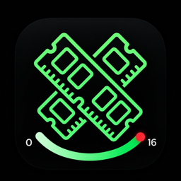
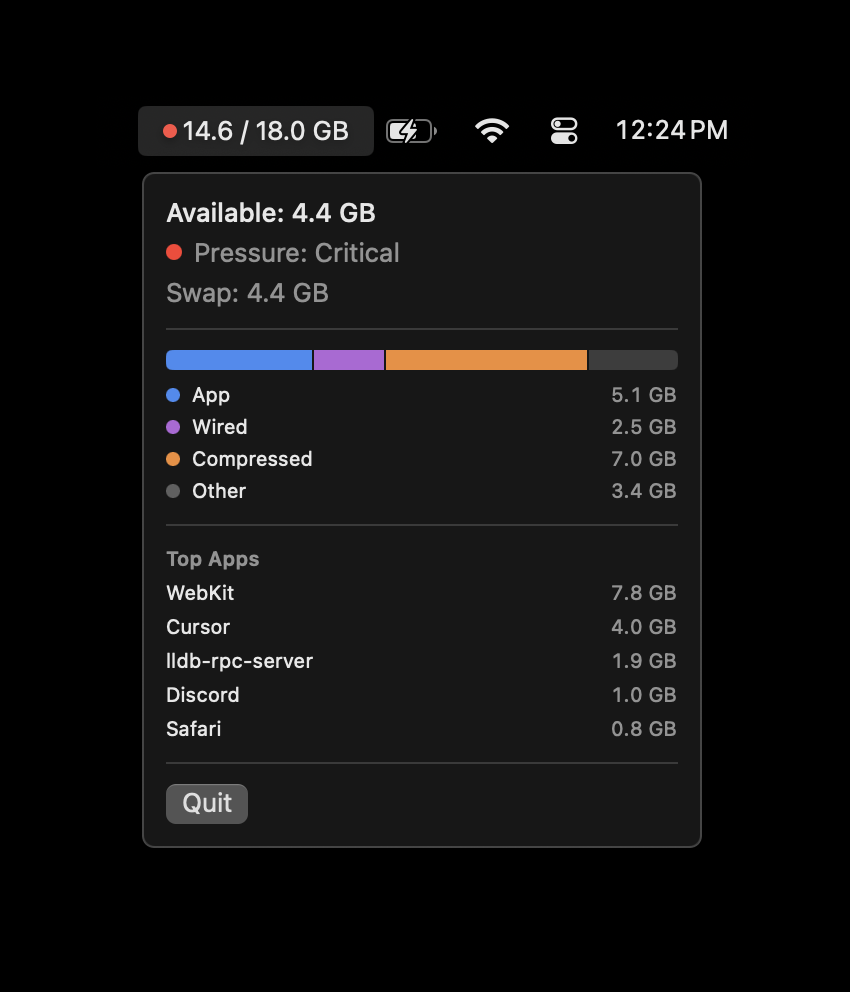

#  MenuRAM

Native macOS menu bar app for live RAM, pressure, and swap.

<p align="center">
  
</p>

<p align="center">
  <em>Always-on used / total in the menu bar. Click for the rest. No Dock icon.</em>
</p>

<p align="center">
  
</p>

<p align="center">
  <em>Lives in the menu bar.</em>
</p>

## Features

- **Menu bar:** pressure color + `Used / Total GB`
- **Available:** free + reclaimable memory
- **Pressure:** Normal / Warning / Critical (same family of signal as Activity Monitor)
- **Swap:** pages on disk (thrash signal)
- **Breakdown:** App, Wired, Compressed, Other
- **Top 5 apps:** ranked by footprint; helpers grouped (Cursor Helper → Cursor, WebKit → Safari/Mail/etc.)
- Hover Available, Pressure, Swap, or the bar for a short explanation

Built with SwiftUI `MenuBarExtra` and Darwin `host_statistics64`.

## Requirements

- macOS 14 or later
- Xcode 16.4 or later

## Install (Release `.app`)

Xcode **Run** is Debug plus the debugger. That copy is for development and uses a lot of extra RAM. For daily use, install a **Release** app and quit the Xcode instance.

```bash
git clone https://github.com/hjo3-cse40/MenuRAM.git
cd MenuRAM
chmod +x scripts/install-local.sh
./scripts/install-local.sh
```

That builds Release, copies `MenuRAM.app` to `~/Applications`, and opens it. Pass `/Applications` if you want it there (may need admin). Then:

1. Quit MenuRAM if it is still running from Xcode (`killall MenuRAM`, then open the installed app).
2. Click the menu extra → **Launch at Login** so login uses this bundle, not DerivedData.

Rebuild the same way after source changes. There is no packaged GitHub download yet.

## Develop in Xcode

```bash
open MenuRAM.xcodeproj
```

Destination **My Mac** → Run. Quit from the popover when you are done debugging.

## How numbers work

| Field | Meaning |
|--------|---------|
| Used | App + Wired + Compressed |
| Total | Physical RAM |
| App | Internal / anonymous pages |
| Available | Free + speculative + inactive + purgeable |
| Top Apps | Per-process `phys_footprint`, helpers folded into the parent name (including WebKit into Safari) |

Top Apps will not sum to App Memory. Different accounting (grouped processes vs VM buckets). That is expected.

Stats refresh about every 2 seconds. Top apps refresh about every 4 seconds.

## License

MIT. See `LICENSE`.

There is no packaged GitHub download or notarized app yet. Local install still needs Xcode to compile.
